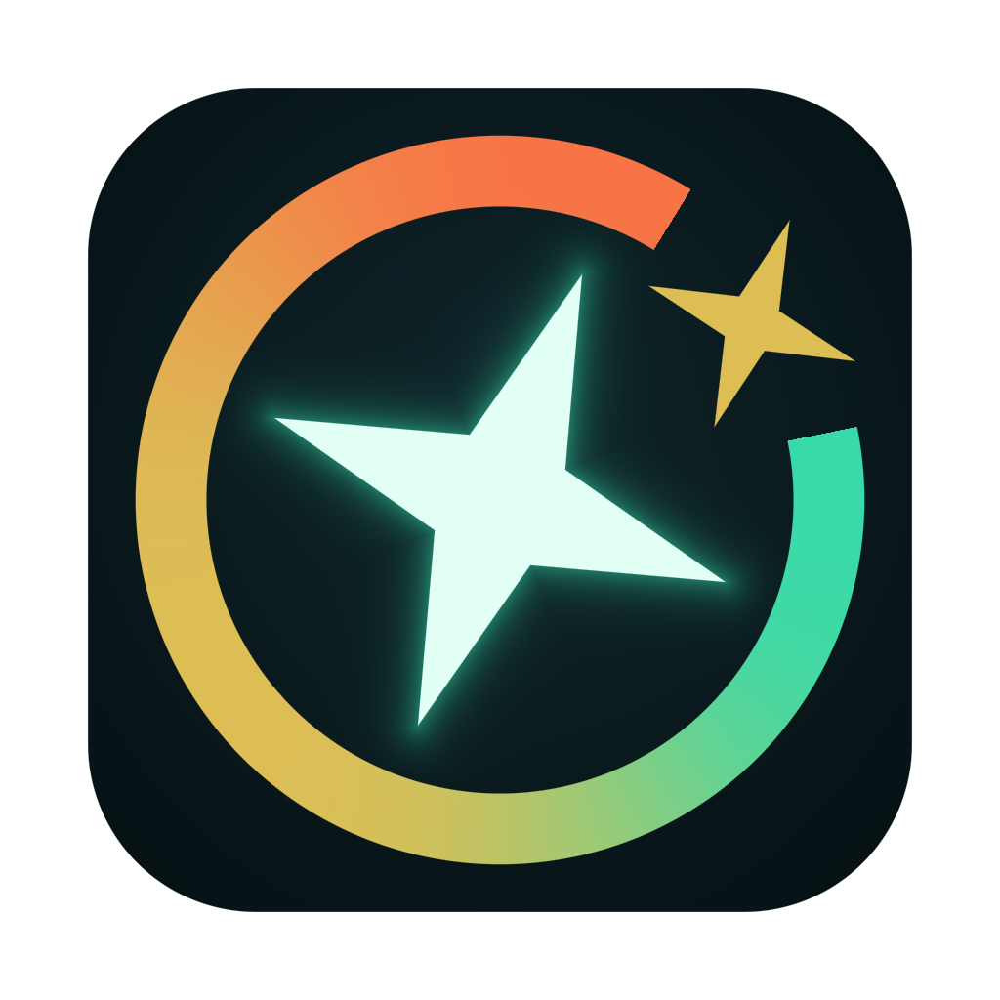

# CodeX状态提醒



在 Mac 菜单栏和桌面圆点里查看 Codex 的周额度、重置时间和最近任务。Codex 在后台时，任务完成会显示提醒卡片；打开或切回 Codex 会撤下全部提醒。点击卡片可打开对应会话，手动关闭只移除这一条；这些操作不改写 Codex 的未读状态。

这是独立的第三方应用，不是 OpenAI 官方产品，不隶属于 OpenAI，也不代表其背书。普通用户不需要另外安装 Electron、Node.js 或 Python。

> 当前下载版本为 **1.9.15（66），Apple Silicon 公开试用版**。安装包使用 ad-hoc 签名，尚未经过 Developer ID 签名和 Apple 公证，首次打开可能被 macOS 阻止。不要关闭系统安全保护。

未读信息暂不可用时，任务显示“待同步”、数量显示“–”，不把未知当作已读。不同真实 Codex 版本仍需分别验证；详见[功能边界](docs/FUNCTIONAL_SPEC.md#已知界限)。

[English](README.en.md) · [使用说明](docs/USER_GUIDE.md) · [功能与边界](docs/FUNCTIONAL_SPEC.md) · [隐私](PRIVACY.md) · [开发与测试](CONTRIBUTING.md)


## 它能做什么

- 看周额度：菜单栏可以直接显示剩余百分比；关闭数字时恢复完整图标。
- 看任务：菜单栏左键展开完整任务卡片，右键打开配置菜单，悬停不弹窗。
- 看提醒：已停止且未查看的任务标为绿色“待查看”；真正运行中的任务为浅黄色“进行中”；已查看且停止的任务为灰色“已处理”。
- 看使用节奏：比较额度消耗和时间进度，默认超前不超过 12 小时为正常使用，超前达到 24 小时进入额度告警。提醒线可调整。
- 自动连接：优先自动发现 Codex 的程序和数据目录，多次失败后才提供手动选择；不修改 Codex 数据。
- 保持轻量交互：任务卡片预先准备并复用，内容变化才更新；异常退出有有限次数的恢复，用户主动退出不重启。

## 下载与安装

[下载 1.9.15 DMG（推荐）](https://github.com/lin3914/codex-status-reminder/releases/download/v1.9.15/CodeX-Status-Reminder-1.9.15-66-trial-macos-arm64.dmg) · [下载 ZIP](https://github.com/lin3914/codex-status-reminder/releases/download/v1.9.15/CodeX-Status-Reminder-1.9.15-66-trial-macos-arm64.zip) · [版本说明与校验值](https://github.com/lin3914/codex-status-reminder/releases/tag/v1.9.15) · [最新发布](https://github.com/lin3914/codex-status-reminder/releases/latest)

仅适用于 M 系列 Mac，暂不提供 Intel 安装包。这里上传的是完成本轮安装与通知验证的原始文件，不是另一份重新构建的应用。包与源码的对应关系见[版本清单](docs/releases/v1.9.15.json)。

1. 先安装 Codex 并正常登录使用。
2. 下载 DMG，打开后把 `CodeX状态提醒.app` 拖入“应用程序”。更新时先退出旧版，再选择替换；不需要清空配置。ZIP 也可解压后安装。
3. 在“应用程序”里打开应用。默认直接进入设置，自动连接 Codex；菜单栏入口始终保留，不显示运行中的 Dock 图标。

如果提示无法验证开发者，只有确认下载来源和校验值可信后，才按 [Apple 官方说明](https://support.apple.com/zh-cn/102445)对本应用单独确认打开。公司受管 Mac 可能不允许此操作。不要关闭 Gatekeeper、执行去隔离命令，或对应用授予它不需要的系统权限；若提示恶意内容或文件损坏，请停止安装并反馈。详见[使用说明](docs/USER_GUIDE.md)。

## 系统与兼容性

应用元数据保留现有 macOS 12.0 最低版本声明；这不等于已经在所有 macOS 12+ 设备上通过实机验证。候选 CI 计划覆盖 macOS 14 / 26、Apple Silicon 与 Intel 构建。macOS 12 / 13、其他设备、真实下载隔离和登录启动仍需发布前验证。

用量优先来自 Codex app-server 的公开方法；桌面任务和未读状态仍使用只读兼容层。Codex 版本变化、第三方模型、API Key 登录或没有周额度的账户，都可能造成部分信息不可用。不可用不是额度为零。详见[兼容性说明](docs/COMPATIBILITY.md)。

## 从源码运行

需要 macOS、Node.js 22、Xcode Command Line Tools（Swift 6+）和 ripgrep。这里的工具只给开发者使用，普通用户无需安装。

```sh
npm ci
npm test
npm run audit:public
npm run build
npm run check:release
```

产物：`.build/products/CodeX状态提醒.app`。该产物为开发测试版，不能用来证明正式下载的签名与公证已经通过。测试默认不读你的 Codex 账户；真实只读验证需自行运行 `npm run test:live`。

## 许可与反馈

原创代码与可授权图标采用 [Apache-2.0](LICENSE)，代码与图标的公开权利已由维护者确认，保留 Electron / Chromium 等第三方许可。公开试用包不等于 Developer ID 公证正式包；后者仍需单独完成签名、公证和目标设备验收。[第三方许可说明](THIRD_PARTY_NOTICES.md)。

报告普通问题时，请提供应用、macOS、Codex 版本和脱敏复现步骤；不要上传账号令牌、数据库或完整会话。安全漏洞按 [SECURITY.md](SECURITY.md) 私密报告。
