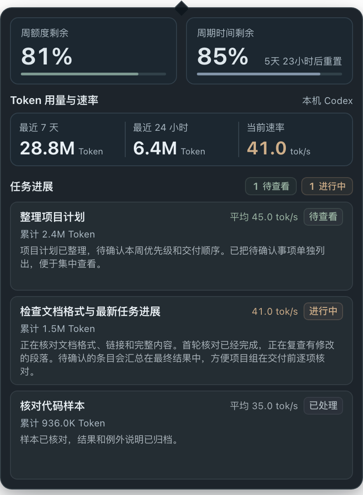

# 状态弹窗：Token 用量与速率

适用于 CodeX状态提醒 1.9.17（78）。

图中使用演示数据。实际面板按以下顺序展示：

- **额度**：周额度剩余、周期时间剩余。重置倒计时放进时间卡，悬停或键盘聚焦可看具体重置时间。比例和进度条使用固定中性色，不再做健康度判断；任务完成提醒照常工作。
- **Token 用量与速率**：最近 7 天、最近 24 小时、当前速率。悬停或键盘聚焦可查看完整用量数字。
- **任务进展**：标题、速率和状态在第一行，速率紧靠状态标签左侧；下一行显示该会话累计 Token。正文保留最多三行最新进展。点击卡片仍在 Codex 中打开相应会话。

## 三类数字怎么读

| 数字 | 口径 |
| --- | --- |
| 最近 7 天、最近 24 小时 | 按上报时间滚动统计本机已连接 Codex 数据目录的主会话，包括可读的归档，不限于面板里的会话。计算新增输入和输出 Token；不会把每次上报的累计值直接相加。不含其他设备或子会话。 |
| 当前速率 | 汇总进行中任务能取得的参考输出速率。仍使用已有的 30 秒、1 分钟或 5 分钟统计范围和最近可信值；已结束任务不会计入。 |
| 会话累计与平均速率 | 累计 Token 是该主会话从开始至今的输入和输出，不随额度周期清零。任务结束后显示的平均速率仍取最近一轮的输出 Token ÷ 该轮运行时长。两项指标的范围和单位不同。 |

Token 用量不会换算成订阅额度或费用。面板直接显示本机记录中可核验的用量，不另加覆盖范围标签；历史缺失时，数值可能低于实际用量。首次建立索引时显示「统计中」；没有可用数字时显示「不可用」；只有确认没有用量时才显示 0。新数据可用后自动更新，无需重开面板。

## 实现与验证

历史用量复用已有的后台读取进程。先补滚动窗口，再补任务列表的会话累计；每批最多读取 8 MiB，并在批次之间让出资源。已处理部分写入本应用的数据目录，仅保存统计所需的索引和校验信息，不保存会话正文。重启后校验并复用索引，正常追加只读新增记录；截断、替换等情况按需重建。休眠、锁屏时暂停补读，不修改 Codex 数据，不新增系统权限。

- 自动化验证：重复上报、跨窗口、归档、子会话排除、日志缺失、截断、追加与索引复用均有独立用例。
- 打包验证：真实 Electron 页面和工作进程通过 6 组检查，包括用 Tab 键查看时间和用量卡片的详情；在隔离模拟数据下，面板关闭约 9.7 秒更新，打开时使用现有缓存，任务停止后约 10 秒退出汇总。
- 本机数据只读探查：滚动窗口首次补齐实际读取约 3 GB；这部分与日常增量读取成本不同。该探查不是整机功耗测量。
- 1.9.17（77）真实数据验证：重启后的首个数据画面已显示缓存用量，抽查的 10 张真实任务卡均显示累计值，标题与进展仍在。构建 78 只调整显示，不改统计或缓存逻辑。
- 1.9.17（78）验证：全量测试和 6 组打包界面检查通过，包含 320 像素宽度、长标题和中英文状态。安装后，实际面板的两个用量汇总均只显示数字与单位，10 张任务卡的速率都在状态左侧、累计用量都在下一行。16 项配置逐项一致；以普通方式重启后，菜单栏可正常展开和收起面板。
