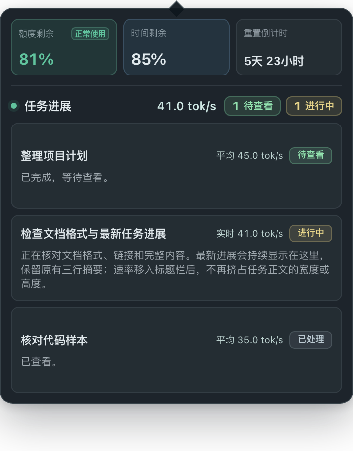
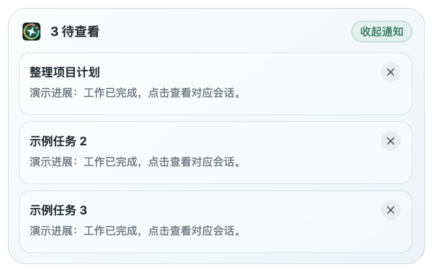
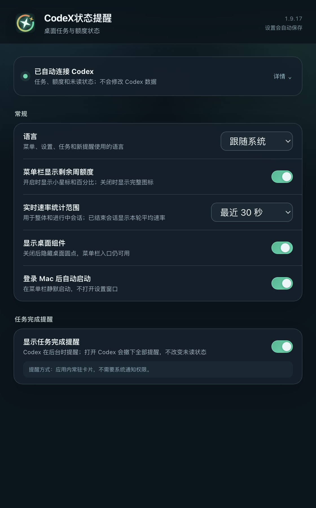

# 使用 CodeX状态提醒

## 开始使用

安装 Codex 并登录，再从[最新发布](https://github.com/lin3914/codex-status-reminder/releases/latest)下载 `CodeX状态提醒.app`，放进“应用程序”。当前为 1.9.16（68）Apple Silicon 试用版，使用 ad-hoc 签名，尚未经过 Developer ID 签名和 Apple 公证。首次打开可能需要你确认可信来源，具体见下方常见问题。

从“应用程序”打开一次，应用会直接进入设置并自动连接，不需要先找 Codex 的安装目录，也不需要填写 API Key。普通用户无需安装 Electron、Node.js 或 Python。

默认开启桌面组件、菜单栏额度数字、任务完成提醒和登录启动。设置自动保存，后续从菜单栏右键进入。应用运行时不出现在 Dock；如果你以前将它固定到 Dock，那是用户保留的快捷方式，需要通过 Dock 的“选项 → 从程序坞中移除”处理。

## 菜单栏和桌面圆点

图中数字为演示额度。以下图片来自候选应用的真实渲染页面，使用虚构任务与固定数据；不是你的账户或真实会话。

菜单栏左键展开／收起任务面板，右键显示配置菜单。鼠标停留在菜单栏图标上不弹出任务卡片。

“在菜单栏显示剩余额度”开启时，显示周额度剩余数字，左上角配小星芒；关闭时显示完整图标。没有可用额度时不会冒充为 0%。

桌面圆点是同一份数据的另一入口。悬停展开任务，点击打开 Codex；拖动圆点时卡片跟随，位置会保存。组件始终高于普通窗口，默认跨桌面空间显示，在全屏应用内隐藏。没有另外的置顶、多空间或移动到当前屏幕配置。

## 任务面板

以下展示 1.9.17（78）本机验证版的布局。公开下载的 1.9.16（68）尚未包含新用量区，整体速率仍放在任务进展标题栏。

顶部并排显示周额度剩余和周期时间剩余，重置倒计时放在时间卡内。两张卡使用固定中性色和细进度条，不按额度高低变色或给出健康度判断。

中间从左到右显示最近 7 天、最近 24 小时的 Token 用量和当前速率。下方任务列表按待查看、进行中、已处理排序，同一状态优先最近活动；超过三张卡片可滚动。圆点中心优先显示待查看任务数，没有待查看时显示剩余额度整数，不加百分号。

| 状态 | 含义 | 样式 |
| --- | --- | --- |
| 待查看 | 任务已经停止，最新内容在 Codex 中仍未读 | 绿色 |
| 进行中 | Codex 表明任务仍在运行，或尚未获取到明确终止状态且当前轮次未结束 | 橙色 |
| 已处理 | 任务已停止，最新内容已被查看 | 灰色 |

等待审批或等待回答可能仍属于活动任务，不意味着 CPU 一直工作。如果明确暂停、中止、取消、失败或结束，将移出“进行中”，再按实际未读状态归入待查看或已处理。运行状态暂不可读时，兼容层可能短暂保留旧判断，不能把本地记录当作绝对实时的权威状态。

点击任务打开对应 Codex 会话。应用不通过改写数据库来把会话标为已读；是否已读由 Codex 客户端决定。

如果未读状态暂时取不到，停止的任务显示“待同步”，待查看数量显示“–”；这表示软件还不知道是否已查看，不会把它当成“已处理”或零条未读。连接恢复后自动更新，不需要修改 Codex 数据。

### Token 用量与速率

会话速率放在标题行、紧靠状态标签左侧。下一行显示累计用量，正文保留最多三行最新进展。累计用量按本会话可核验的历史记录统计输入和输出，不限于最近一轮或最近七天。

最近 7 天和最近 24 小时都是滚动窗口，24 小时已经包含在 7 天内，不要相加。两者统计当前连接的本机主会话，含可读取的归档会话；不含其他设备和子会话。用量不随周期额度重置。面板直接展示可核验的数字，未记录的用量不计入。首次加载显示「统计中」，无可用数字时显示「不可用」。悬停用量可看完整数字。

行内速率与对应状态标签同色：进行中为橙色，待查看为绿色，已处理为灰色。中间摘要的「当前速率」只加总进行中会话的输出速率；待查看和已处理的平均速率不计入。

- 进行中直接显示数值，例如“28.5 tok/s”。应用使用当前可信的任务速率；收到新用量后自动更新，等待上报期间保持已有值。
- 已停止显示“平均”：最近一轮任务的输出 Token，除以这一轮从开始到结束的时间，包含工具和等待时间，不计你两次发送消息之间的空闲。
- 从未取得有效参考值的运行任务显示“待上报”。整体汇总也直接显示数值；全部会话停止后显示0，已结束任务的平均值不会进入合计。

在“设置 → 常规 → 实时速率统计范围”中选择最近 30 秒、1 分钟或 5 分钟，默认 30 秒。选择后立即保存，并同时用于整体和进行中会话；已结束会话的本轮平均值不受这个选项影响。任务面板不再单独显示采样范围或更新时间。

默认的30秒是用来算速率的数据范围，不是刷新间隔。Codex写入新用量后，应用通常会通过文件变化通知更新。有进行中任务时，如果漏掉文件通知，面板打开时约每3秒检查一次，关闭时约每10秒检查一次；文件没变就不读取会话内容。打开面板直接显示已缓存的数据。没有新用量时，同一轮任务保持已有值；没有可信记录时显示“待上报”。没有进行中任务、锁屏或睡眠时，额外检查暂停。

`tok/s` 表示每秒输出的 Token 数，包含模型思考 Token，不含输入和缓存 Token。Codex 会分批上报用量，所以数字会间歇变化；这项指标适合观察近期产出。任务卡片和悬停说明不区分上报间隔，也不单独展示采样范围。

1.9.17（74）起，较长的会话会在后台分段补齐最近一轮的开始记录和用量基线，解决末尾记录不足以计算平均值的问题。补齐期间平均值暂为“—”，完成后自动显示，不需要打开面板等待重新采样；原始记录缺少开始、结束或用量时仍保留未知。

## 任务完成提醒

默认在 Codex 不在前台、任务新一轮完成且未读时显示提醒。完成以 Codex 的任务完成事件为依据，不把取消或中止当作成功完成。标题直接使用会话名称，图标放在标题行，不占任务详情的宽度。

多条提醒采用分组堆叠，最新完成的在前；展开后可逐条查看。提醒不会因固定计时自动消失。只要打开或切回 Codex，全部提醒都会撤下，不必逐条打开会话；离开 Codex 后不会重新弹出这些旧提醒。

点击提醒会立即撤下这一条，并请求 Codex 打开对应会话；Codex 成为前台应用后，其余提醒也一起撤下。关闭按钮仍只移除这一条。撤下提醒不改变 Codex 中的未读状态，任务仍可在“待查看”列表中找到；同一轮完成不会反复提醒。

点击提醒不等于已经读完。若会话跳转失败，这条提醒仍已撤下，任务可以继续出现在“待查看”列表；可从任务面板再次打开。

这是应用自绘的常驻提醒，不是 macOS 通知中心横幅。系统可能用原生通知作为异常回退，但原生通知的停留时间和按钮由系统控制，不能保证与常驻卡片完全相同。关闭提醒开关后不再显示；开启时不会把所有历史未读任务重新轰炸一遍。

提醒位于普通文档窗口上方，使用标准浮动窗口层级，不占据系统最高层。其他应用后来弹出的系统通知可以正常覆盖它；任务状态刷新也不会反复把提醒抬到最前。

1.9.14 在漏发修复基础上补齐故障恢复：前台或未读状态暂时读不到时等待下次正常同步；已显示的提醒缓存标题和摘要，重启暂缺数据时也能恢复。未读数据已成功读取但标记尚未出现时，最多等待 10 分钟对齐；明确仍未读的任务不会仅因等待超时被丢弃。通知窗口异常会有限重建，不反复重启整个软件。重新开启提醒不补发关闭期间的消息，也不把稍后才发现的历史任务当作新消息。

提醒不是无限消息存档：最多保留最近 100 条待查看提醒和 100 条待判断记录。关闭、查看或关闭提醒开关后，会按相应规则清理。磁盘不可写且进程退出时，尚未保存的提醒不能保证恢复。

## 连接和常规设置

- 语言：跟随系统、简体中文或 English。
- 登录启动：登录 Mac 后静默启动，不自动弹出设置页；系统可能要求允许登录项。
- 显示桌面组件：关闭圆点后，菜单栏入口仍然存在。
- 菜单栏额度：切换数字与完整图标。
- 任务完成提醒：控制常驻提醒。

连接正常时无需操作。应用检查标准目录、有效的已连接位置和可发现的 Codex 程序；多次发现失败后才显示手动选择数据文件夹的入口。这里选择的是 Codex **数据目录**，不是一定要选 Codex.app 所在文件夹。

## 常见问题

**菜单栏没有图标**：先确认只有一份应用在运行，已安装在“应用程序”。检查系统菜单栏显示开关和第三方菜单栏管理工具。正常显示不要求辅助功能或屏幕录制权限。若仍不可见，提供脱敏截图和版本信息；不要还原整个控制中心或执行网上的私有偏好修改命令。

**额度、时间显示待同步**：确认 Codex 已登录且该账户有可读的周期额度。网络、服务错误、API Key／第三方模型或 Codex 协议变化都可能影响显示。不要为了排查上传 auth.json。

**任务计数与 Codex 不同**：先比较同一时刻的顶层本地会话；子任务、已归档／远程会话和版本兼容性可能影响范围。明确停止的任务不应继续算进行中；请报告复现，不要手动改数据库。

**提示无法验证开发者**：当前公开试用包尚未经过 Developer ID 签名和公证，这类提示可能发生在首次打开时，不是注册或登录问题。先核对下载来源、版本及 SHA256SUMS；只有确认来源可信且文件未被修改后，才按 [Apple 官方说明](https://support.apple.com/zh-cn/102445)，尝试打开后到“系统设置 → 隐私与安全性”单独确认“仍要打开”。公司受管 Mac 可能不允许确认。不要关闭 Gatekeeper 或删除隔离标记；若系统提示恶意内容或文件损坏，请停止并反馈。

## 更新与卸载

本版本没有自动更新器；从[最新发布](https://github.com/lin3914/codex-status-reminder/releases/latest)下载新版本，正常退出应用后替换“应用程序”中的同名应用，保留现有配置。不需要卸载或清空 Codex 数据。只保留一份，不同时从下载目录、挂载镜像和应用程序运行不同副本。

卸载时先关闭“登录启动”，从菜单栏退出，再将“应用程序”中的本应用移到废纸篓。要清除配置，可另行移除 `~/Library/Application Support/codex-companion` 和 Electron 的应用自身缓存。不要删除 `~/.codex`，那是 Codex 的会话与账号数据。macOS 保留的历史菜单栏记录由系统管理，本应用不提供修改其私有数据库的卸载脚本。
